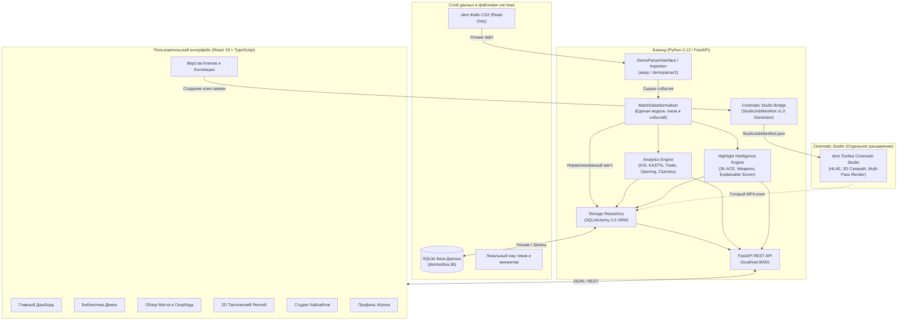

# dem.Toshka (Основное приложение) — Обзор архитектуры системы

**Дата:** 19 ноября 2026 г.  
**Ветка:** `feature/product-takeover-overhaul`  
**Статус:** Утверждённый архитектурный документ  
**Область:** Архитектура основного приложения **dem.Toshka** (Local-First CS2 Companion & Content Discovery Platform).

---

## 1. Архитектурные принципы и цели

1. **Local-First & Offline:** Приложение функционирует на локальном компьютере пользователя. Все вычисления, парсинг демок, анализ статистики и сохранение базы данных происходят локально без облачных серверов и абонентской платы.
2. **Неприкосновенность пользовательских файлов:** Оригинальные файлы `.dem` открываются строго в режиме «только для чтения» (`rb`). Изменение, перезапись или удаление исходных демо-файлов запрещены на уровне архитектуры.
3. **Модульная изоляция:** Парсер, аналитический движок, детектор хайлайтов, хранилище данных, веб-интерфейс и интеграционный мост со студией выделены в независимые слабосвязанные модули.
4. **Четкое разделение с Cinematic Studio:** Основное приложение dem.Toshka управляет данными матчей, поиском моментов и формированием клип-заявок (`StudioJobManifest`). Все вопросы HLAE-инъекций, свободных 3D камер и видеомонтажа делегированы отдельному опциональному модулю Cinematic Studio.

---

## 2. Диаграмма компонентов и потоков данных

---

## 3. Детальное описание подсистем

### 3.1 Подсистема парсинга и нормализации (`backend/parser/`)
- **Задача:** Извлечение структурированных данных из бинарного формата демок CS2 (Source 2).
- **Слой адаптера (`DemoParserInterface`):** Обеспечивает изоляцию ядра приложения от конкретной парсер-библиотеки (`awpy`, `demoparser2`). В случае изменения формата демки Valve заменяется лишь внутренняя реализация адаптера.
- **Нормализация времени:** Строгое разделение понятий `tick` (дискретный номер тика), `time_seconds` (секунды матча), `round_num` (номер раунда).
- **Валидация событий:** Фильтрация самоубийств (`weapon='world'`), тимкиллов и взрывов бомбы (`planted_c4`) с установкой соответствующих булевых флагов `is_suicide` и `is_teamkill`.

### 3.2 Аналитический движок (`backend/analytics/`)
- **`match_stats.py`:** Расчёт честного скорборда:
  - Исключение самоубийств и тимкиллов из показателя фрагов.
  - Расчёт KAST % (Kill, Assist, Survived, Traded).
  - Определение первых дуэлей раунда (Opening Kills / First Deaths).
  - Поиск цепочек разменов (Trade Kills в окне 4.0 секунд).
  - Расчёт KPR (Kills per round) и DPR (Deaths per round).
- **`player_analytics.py`:** Глубокий профиль игрока:
  - Процент побед в дуэлях за разные стороны (T/CT).
  - Точность первой пули и процент хедшотов по видам оружия.
  - Оценка успешности в клатчах (1v1, 1v2, 1v3+).

### 3.3 Детектор хайлайтов и скоринг (`backend/detector/`)
- **Детекция серий:** Поиск мультикиллов (2K, 3K, 4K, 5K/ACE) с учетом максимальной паузы между фрагами (по умолчанию 4 секунды).
- **Клатч-детекция:** Выявление раундов, где игрок оставался один против нескольких живых соперников и привел команду к победе.
- **Оружейные категории:** Выделение хайлайтов с AWP, Scout, пистолетами (Deagle), выстрелов в прыжке, ноускопов и прострелов через стены/дым.
- **Объяснимый скоринг (`scorer.py`):** Каждому моменту начисляется прозрачный балл от 0 до 100 на основе:
  - Количества фрагов (+30 за 3K, +50 за 4K, +75 за ACE);
  - Скорости совершения серии (бонус за плотность выстрелов);
  - Процента хедшотов и сложности оружия;
  - Статуса клатча (+15..+25 баллов);
  - Решающего вклада в исход раунда.
- **Умные границы клипов (Dynamic Padding):** Автоматический отступ 3–7 секунд до первого фрага и 2–5 секунд после последнего с жестким ограничением границами раунда (не вылезая во фризтайм или следующий раунд).

### 3.4 Хранилище и кэш (`backend/storage/`)
- **База данных:** SQLite через SQLAlchemy 2.0 (`backend/storage/models.py`).
- **Ключевые сущности:** `demos`, `players`, `rounds`, `kills`, `highlights`, `collections`, `rendered_assets`.
- **Идемпотентность и кэширование:** Каждая демка идентифицируется уникальным SHA-256 хэшем (`fingerprint`). Повторный импорт файла мгновенно возвращает кэшированные данные из базы без повторного парсинга.

### 3.5 Интеграция с Cinematic Studio (`CinematicStudioConnector`)
- Основное приложение не выполняет HLAE-инъекций и не управляет сплайн-камерами напрямую.
- Вместо этого формируется структурированный файл-задание `StudioJobManifest` версии 1.0, содержащий:
  - Абсолютный путь к оригинальной демке;
  - Тикрейт и карту;
  - Диапазон тиков (`clip_start_tick` .. `clip_end_tick`);
  - SteamID и имя игрока (Hero POV);
  - Список всех ключевых событий внутри клипа с точными тиками;
  - Категорию момента, скоринг и пользовательские теги.
- Cinematic Studio считывает манифест, выполняет съемку и рендеринг, после чего dem.Toshka автоматически регистрирует готовый видеофайл в своей локальной медиатеке.
