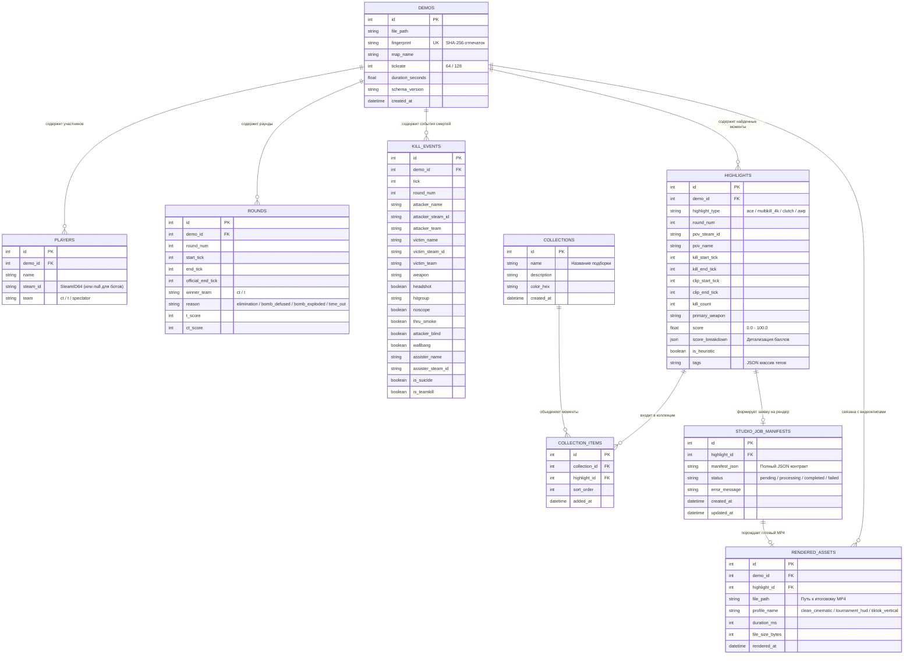

# Модель данных и схема хранилища dem.Toshka

**Дата:** 19 ноября 2026 г.  
**Ветка:** `feature/product-takeover-overhaul`  
**Статус:** Утверждённая спецификация схемы данных  
**СУБД:** SQLite 3 (через SQLAlchemy 2.0 ORM)  
**Файл БД:** `demtoshka.db` (локальный каталог приложения)

---

## 1. Концепция и правила целостности

1. **Реляционная целостность:** Все дочерние таблицы (`players`, `rounds`, `kills`, `highlights`, `rendered_assets`) связаны внешними ключами с таблицей `demos` с каскадным удалением (`ON DELETE CASCADE`). При удалении демки из библиотеки все связанные с ней раунды, фраги и кэш очищаются автоматически.
2. **Идентификация и дедупликация (`fingerprint`):** Каждая демка хешируется алгоритмом SHA-256 по первым 16 МБ и метаданным файла. Это гарантирует мгновенное определение дубликатов даже при переименовании файла.
3. **Версионирование схемы (`schema_version`):** Каждая запись в таблице `demos` хранит номер версии схемы парсера. При мажорном обновлении моделей данных устаревший кэш легко выявляется и при необходимости пересоздается.
4. **Безопасность отсутствующих полей:** Поля, которые могут отсутствовать в старых или неполных демках, строго помечены как `nullable=True` (`Optional[...]`), что исключает сбои при десериализации.

---

## 2. ER-диаграмма сущностей

---

## 3. Описание таблиц и полей

### 3.1 `demos` — Основная информация о матче
- `id` (INTEGER, PK): Уникальный суррогатный идентификатор.
- `file_path` (VARCHAR(1024)): Полный локальный путь к файлу `.dem`.
- `fingerprint` (VARCHAR(64), UNIQUE, INDEX): Контрольная сумма SHA-256 для исключения повторного парсинга одного и того же файла.
- `map_name` (VARCHAR(128)): Официальное имя карты (`de_mirage`, `de_nuke`, `de_anubis` и др.).
- `tickrate` (INTEGER): Частота обновления сервера (64 или 128 тиков/сек).
- `duration_seconds` (FLOAT): Общая длительность матча в секундах.
- `schema_version` (VARCHAR(32)): Версия схемы нормализатора (`1`, `2` и т.д.).
- `created_at` (DATETIME): Время первичного импорта в библиотеку.

### 3.2 `rounds` — Структура раундов
- `round_num` (INTEGER): Порядковый номер раунда (начиная с 1).
- `start_tick` (INTEGER): Тик старта раунда (окончание фризтайма).
- `end_tick` (INTEGER): Тик фиксации победы одной из команд.
- `official_end_tick` (INTEGER): Тик окончательного завершения раунда (начало следующего фризтайма). Используется для безопасного ограничения постролла клипов.
- `winner_team` (VARCHAR(32)): Победитель раунда (`ct` или `t`).
- `reason` (VARCHAR(64)): Причина победы (`elimination`, `bomb_defused`, `bomb_exploded`, `time_out`).
- `t_score`, `ct_score` (INTEGER): Счет команд после завершения раунда.

### 3.3 `kill_events` — Детализированные события убийств
- Содержит все характеристики дуэли: координаты атакующего и жертвы, оружие, хедшот, прострелы через стены и дым, статус ослепления, флаги `is_suicide` и `is_teamkill`.

### 3.4 `highlights` — Найденные яркие моменты
- `highlight_type`: Тип хайлайта (`ace`, `multikill_4k`, `clutch_candidate`, `awp_highlight` и др.).
- `clip_start_tick`, `clip_end_tick`: Динамически рассчитанные границы клипа с учетом преролла и постролла, безопасно зажатые в границах раунда.
- `score` (FLOAT): Итоговая оценка зрелищности (от 0 до 100).
- `score_breakdown` (TEXT/JSON): Полная детализация каждого начисленного балла (для честного объяснения пользователю в интерфейсе).

### 3.5 `collections` и `collection_items` — Организация контента
- Позволяет пользователям объединять хайлайты из разных матчей в тематические плейлисты (например, для создания монтажей или портфолио).

### 3.6 `rendered_assets` — Локальная медиатека готовых клипов
- Хранит ссылки на отрендеренные MP4-видеоролики, их размер, разрешение и привязку к исходному хайлайту.

---

## 4. Стратегия миграций и валидация кэша

1. **Безопасные миграции:** Добавление новых колонок (`ALTER TABLE ADD COLUMN`) выполняется автоматически при старте приложения через вспомогательный модуль `backend/storage/database.py`.
2. **Инвалидация кэша:** Если константа `SCHEMA_VERSION` в коде парсера меняется, хранилище помечает старые записи как требующие обновления, предоставляя пользователю возможность фоновой переиндексации без потери избранного и пользовательских тегов.
3. **Очистка сиротских записей:** Благодаря внешним ключам `ON DELETE CASCADE`, удаление демки мгновенно и чисто удаляет все связанные с ней раунды, фраги и хайлайты, сохраняя базу компактной и быстрой.
