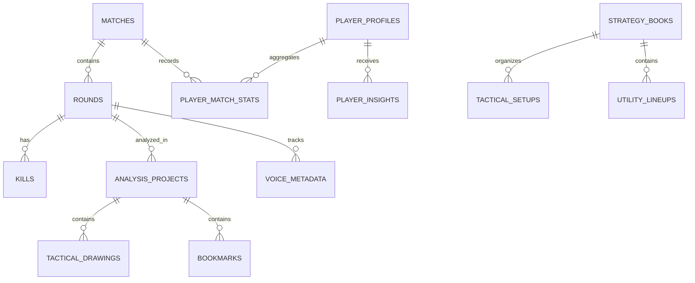

# dem.Toshka Core — Модель данных, схема SQLite и спецификация API

**Версия документа:** 1.0  
**Дата:** 23 ноября 2026 г.  
**Модуль:** `dem.Toshka Core :: Unified Data Model & API Specifications`  
**Статус:** Готово к реализации  

---

## 1. Концепция и обратная совместимость

Модель данных `dem.Toshka Core` построена на реляционной базе данных **SQLite** с обеспечением строгой обратной совместимости. Все существующие таблицы (`demos`, `matches`, `rounds`, `kills`, `clips`, `render_tasks`, `highlights`) сохраняют свою структуру и целостность. Новая функциональность **Demo Vision**, **Player Analytics** и **Strategy Book** добавляется через расширение схемы новыми нормализованными таблицами с префиксом предметных областей.

Версия схемы БД повышается с `1.2.0` до `2.0.0`. При первом запуске модуль миграций автоматически применяет инкрементальные DDL-скрипты без перезаписи или удаления пользовательских клипов и настроек.

---

## 2. Диаграмма сущностей (Entity-Relationship Diagram)



---

## 3. Схема таблиц SQLite (DDL)

### 3.1. Существующие базовые таблицы (сохранены без изменений)
* `demos` — пути к файлам `.dem`, хэши, размер, дата обнаружения, статус парсинга.
* `matches` — метаданные матча (карта, дата, длительность, счет команд, тикрейт).
* `rounds` — границы раундов (тикрейт, начальный/конечный тики, победитель, тип победы).
* `kills` — лог фрагментов (атакующий, жертва, оружие, хедшот, прострел, тик).
* `clips` — сохраненные пользовательские клипы для монтажа и рендера.

---

### 3.2. Новые таблицы для Demo Vision (Проекты, Рисование, Звук, Закладки)

```sql
-- Проекты тактического разбора матча
CREATE TABLE IF NOT EXISTS analysis_projects (
    id TEXT PRIMARY KEY,                   -- UUID проекта
    match_id TEXT NOT NULL,                -- Связь с таблицей matches
    title TEXT NOT NULL,                   -- Пользовательское название разбора
    description TEXT,                      -- Заметки к проекту
    created_at TIMESTAMP DEFAULT CURRENT_TIMESTAMP,
    updated_at TIMESTAMP DEFAULT CURRENT_TIMESTAMP,
    FOREIGN KEY (match_id) REFERENCES matches(id) ON DELETE CASCADE
);

-- Слой тактического рисования (векторные элементы)
CREATE TABLE IF NOT EXISTS tactical_drawings (
    id TEXT PRIMARY KEY,                   -- UUID элемента рисования
    project_id TEXT NOT NULL,              -- Связь с analysis_projects
    round_id TEXT NOT NULL,                -- Связь с rounds
    tick INTEGER,                          -- Конкретный тик (NULL = видно весь раунд)
    layer_type TEXT NOT NULL,              -- 'PEN', 'ARROW', 'LINE', 'CIRCLE', 'ZONE', 'TEXT', 'MARKER'
    color TEXT NOT NULL,                   -- HEX-код цвета (#00f2fe, #facc15 и др.)
    stroke_width REAL NOT NULL DEFAULT 3.0,
    geometry_json TEXT NOT NULL,           -- JSON с координатами точек {x1, y1, x2, y2, points: [...]}
    text_label TEXT,                       -- Текстовая подпись (для слоя TEXT)
    created_at TIMESTAMP DEFAULT CURRENT_TIMESTAMP,
    FOREIGN KEY (project_id) REFERENCES analysis_projects(id) ON DELETE CASCADE
);

-- Временные закладки к тикам матча
CREATE TABLE IF NOT EXISTS bookmarks (
    id TEXT PRIMARY KEY,                   -- UUID закладки
    project_id TEXT NOT NULL,              -- Связь с analysis_projects
    round_number INTEGER NOT NULL,         -- Номер раунда
    tick INTEGER NOT NULL,                 -- Точный тик события
    player_steamid TEXT,                   -- Привязанный игрок (опционально)
    category TEXT NOT NULL,                -- 'TACTICAL_MISTAKE', 'CLUTCH', 'UTILITY_SETUP', 'COMM_ERROR', 'GREAT_PLAY'
    title TEXT NOT NULL,                   -- Краткий заголовок
    notes TEXT,                            -- Развернутый комментарий тренера
    created_at TIMESTAMP DEFAULT CURRENT_TIMESTAMP,
    FOREIGN KEY (project_id) REFERENCES analysis_projects(id) ON DELETE CASCADE
);

-- Метаданные голосового чата демки
CREATE TABLE IF NOT EXISTS voice_tracks (
    id TEXT PRIMARY KEY,
    match_id TEXT NOT NULL,
    player_steamid TEXT NOT NULL,
    player_name TEXT NOT NULL,
    team_side TEXT NOT NULL,               -- 'CT' | 'TERRORIST'
    packet_count INTEGER NOT NULL,         -- Количество пакетов Opus
    duration_seconds REAL NOT NULL,        -- Суммарное время разговора
    sample_rate INTEGER DEFAULT 48000,
    has_audio_data BOOLEAN DEFAULT 1,
    audio_cache_path TEXT,                 -- Путь к локально декодированному Ogg/WAV
    FOREIGN KEY (match_id) REFERENCES matches(id) ON DELETE CASCADE
);
```

---

### 3.3. Новые таблицы для Player Analytics (Многоматчевая аналитика и рекомендации)

```sql
-- Профиль постоянного игрока
CREATE TABLE IF NOT EXISTS player_profiles (
    steamid TEXT PRIMARY KEY,              -- 64-битный SteamID игрока
    display_name TEXT NOT NULL,            -- Основной никнейм
    team_tag TEXT,                         -- Клантег / Команда
    primary_role TEXT,                     -- 'ENTRY', 'AWPER', 'SUPPORT', 'IGL', 'LURKER', 'ANCHOR'
    preferred_crosshair_code TEXT,
    notes TEXT,
    created_at TIMESTAMP DEFAULT CURRENT_TIMESTAMP
);

-- Агрегированные продвинутые метрики за матч (для быстрого построения трендов)
CREATE TABLE IF NOT EXISTS player_match_stats (
    id TEXT PRIMARY KEY,
    match_id TEXT NOT NULL,
    steamid TEXT NOT NULL,
    team_side TEXT NOT NULL,               -- 'CT' / 'T' / 'BOTH'
    map_name TEXT NOT NULL,
    rounds_played INTEGER NOT NULL,
    kills INTEGER NOT NULL,
    deaths INTEGER NOT NULL,
    assists INTEGER NOT NULL,
    adr REAL NOT NULL,
    headshot_pct REAL NOT NULL,
    kast_pct REAL NOT NULL,
    rating_custom REAL NOT NULL,           -- Стандартизированная оценка перформанса
    
    -- Продвинутые метрики микро- и макро-игры
    crosshair_placement_error_deg REAL,    -- Средняя угловая ошибка прицела (градусы)
    time_to_damage_ms REAL,                -- Среднее время нанесения урона после контакта (мс)
    untradeable_deaths_count INTEGER,      -- Количество смертей в изоляции
    untradeable_deaths_pct REAL,           -- % смертей без возможности размена
    dry_repicks_count INTEGER,             -- Количество сухих повторных пиков
    trade_kill_conversion_pct REAL,        -- % успешных разменов тиммейтов за 4.0 сек
    traded_death_pct REAL,                 -- % собственных смертей, которые были разменяны
    team_flash_ratio REAL,                 -- Отношение ослеплений врагов к союзникам
    clutches_won INTEGER DEFAULT 0,
    clutches_total INTEGER DEFAULT 0,
    
    created_at TIMESTAMP DEFAULT CURRENT_TIMESTAMP,
    FOREIGN KEY (match_id) REFERENCES matches(id) ON DELETE CASCADE,
    FOREIGN KEY (steamid) REFERENCES player_profiles(steamid) ON DELETE CASCADE
);

-- Хранилище сгенерированных доказательных рекомендаций (Actionable Insights)
CREATE TABLE IF NOT EXISTS player_insights (
    id TEXT PRIMARY KEY,
    steamid TEXT NOT NULL,
    pattern_name TEXT NOT NULL,            -- Название паттерна (напр. 'Bad Repick with AWP')
    sample_size_desc TEXT NOT NULL,        -- '8 случаев за последние 10 матчей'
    exemplar_match_id TEXT NOT NULL,       -- ID матча с ярким примером
    exemplar_round INTEGER NOT NULL,       -- Номер раунда
    exemplar_tick INTEGER NOT NULL,        -- Точный тик
    exemplar_map TEXT NOT NULL,            -- Карта (de_mirage)
    metric_measured TEXT NOT NULL,         -- 'TTK 180ms, угол раскрытия 3'
    metric_benchmark TEXT NOT NULL,        -- 'Оптимум: уход в укрытие'
    root_problem TEXT NOT NULL,            -- Корневая ошибка
    actionable_alternative TEXT NOT NULL,  -- Конкретный план исправления
    is_resolved BOOLEAN DEFAULT 0,         -- Отметка об исправлении игроком
    created_at TIMESTAMP DEFAULT CURRENT_TIMESTAMP,
    FOREIGN KEY (steamid) REFERENCES player_profiles(steamid) ON DELETE CASCADE
);
```

---

### 3.4. Новые таблицы для Strategy Book (Плейбуки, Сетапы, Раскидки)

```sql
-- Тактические книги команд / игроков
CREATE TABLE IF NOT EXISTS strategy_books (
    id TEXT PRIMARY KEY,
    title TEXT NOT NULL,                   -- Напр. 'NaVi 2026 Playbook'
    team_name TEXT,
    author TEXT,
    version TEXT DEFAULT '1.0',
    description TEXT,
    is_default BOOLEAN DEFAULT 0,
    created_at TIMESTAMP DEFAULT CURRENT_TIMESTAMP,
    updated_at TIMESTAMP DEFAULT CURRENT_TIMESTAMP
);

-- Тактические сетапы внутри книги
CREATE TABLE IF NOT EXISTS tactical_setups (
    id TEXT PRIMARY KEY,
    book_id TEXT NOT NULL,
    map_name TEXT NOT NULL,                -- 'de_mirage', 'de_inferno' и т.д.
    side TEXT NOT NULL,                    -- 'T' | 'CT'
    category TEXT NOT NULL,                -- 'DEFAULT', 'EXECUTE', 'RETAKE', 'SLOW_PLAY', 'ECO_PUSH'
    title TEXT NOT NULL,                   -- Напр. 'A-Split Execute with 3 Smokes'
    description TEXT,                      -- Пошаговое текстовое руководство
    timing_seconds INTEGER,                -- Ожидаемый тайминг исполнения
    player_positions_json TEXT NOT NULL,   -- Координаты и роли фишек игроков (P1..P5)
    drawing_canvas_json TEXT,              -- Векторные стрелки и линии захода
    created_at TIMESTAMP DEFAULT CURRENT_TIMESTAMP,
    FOREIGN KEY (book_id) REFERENCES strategy_books(id) ON DELETE CASCADE
);

-- Каталог гранат и ориентиров (Utility Book)
CREATE TABLE IF NOT EXISTS utility_lineups (
    id TEXT PRIMARY KEY,
    book_id TEXT,                          -- Привязка к книге (или общая библиотека)
    map_name TEXT NOT NULL,
    grenade_type TEXT NOT NULL,            -- 'SMOKE', 'FLASH', 'MOLOTOV', 'HE'
    side TEXT NOT NULL,                    -- 'T' | 'CT'
    title TEXT NOT NULL,                   -- Напр. 'Mirage Window Smoke from T-Spawn'
    throw_type TEXT NOT NULL,              -- 'JUMPTHROW', 'STAND', 'RUNTHROW', 'CROUCH'
    tickrate TEXT DEFAULT 'ALL',           -- '64', '128', 'SUBTICK'
    pos_x REAL NOT NULL,                   -- Координата броска X
    pos_y REAL NOT NULL,                   -- Координата броска Y
    pos_z REAL NOT NULL,                   -- Координата броска Z
    target_zone TEXT NOT NULL,             -- 'Window', 'Jungle', 'Stairs', 'B Site'
    image_lineup_path TEXT,                -- Локальный скриншот прицела
    video_snippet_path TEXT,               -- Короткий фрагмент броска (опционально)
    description TEXT,
    created_at TIMESTAMP DEFAULT CURRENT_TIMESTAMP
);
```

---

## 4. Спецификация REST API Эндпоинтов

### 4.1. Demo Vision API

#### `GET /api/replay/{demo_id}/round/{round_id}`
Возвращает синхронизированную покадровую модель раунда для 2D-радара.
* **Query параметры:** `step_ticks` (по умолчанию 16, для ультра-плавности 4 или 8).
* **Схема ответа JSON:**
```json
{
  "round_id": "r_14",
  "map_name": "de_mirage",
  "tickrate": 64,
  "start_tick": 45000,
  "freeze_end_tick": 45960,
  "end_tick": 53200,
  "has_voice_data": true,
  "frames": [
    {
      "tick": 46000,
      "seconds_elapsed": 0.625,
      "bomb": {
        "status": "HELD",
        "carrier_steamid": "76561198000000001",
        "x": -1420.5, "y": -310.2, "z": -120.0
      },
      "players": [
        {
          "steamid": "76561198000000001",
          "name": "s1mple",
          "team": "T",
          "x": -1420.5, "y": -310.2, "z": -120.0,
          "radar_x": 42.15, "radar_y": 55.40,
          "yaw": 184.2,
          "pitch": -4.1,
          "health": 100,
          "armor": 100,
          "has_helmet": true,
          "has_defuser": false,
          "active_weapon": "ak47",
          "is_alive": true,
          "is_flashed": false,
          "flash_duration": 0.0
        }
      ],
      "active_utilities": [
        {
          "id": "smoke_11",
          "type": "SMOKE",
          "center_x": 45.2, "center_y": 62.1,
          "radius": 144.0,
          "seconds_remaining": 17.4
        }
      ]
    }
  ],
  "events": [
    {
      "tick": 48210,
      "type": "KILL",
      "attacker_steamid": "76561198000000001",
      "victim_steamid": "76561198000000002",
      "weapon": "ak47",
      "is_headshot": true,
      "is_through_smoke": false
    }
  ]
}
```

#### `GET /api/replay/{demo_id}/round/{round_id}/voice`
Возвращает аудио-потоки переговоров раунда по дорожкам игроков.
* **Ответ:** Список дорожек с временными интервалами речи, URL для стриминга Ogg Opus и массивом амплитудных значений (waveform) для отрисовки холста.

#### `POST /api/projects/{project_id}/drawings`
Сохраняет векторный элемент или снимок тактического рисования.

#### `POST /api/projects/{project_id}/bookmarks`
Создает временную закладку с комментариями на конкретном тике.

---

### 4.2. Player Analytics API

#### `GET /api/analytics/players/{steamid}/summary`
Возвращает многоматчевую сводку (по умолчанию за последние 20 матчей): радар навыков, распределение по картам, процент безответных смертей, точность трейдов и тайминги урона.

#### `GET /api/analytics/players/{steamid}/insights`
Возвращает структурированный список доказательных рекомендаций по 7-компонентному контракту с координатами для быстрого прыжка в Demo Vision.

---

### 4.3. Strategy Book API

#### `GET /api/strategy/books`
Получение списка плейбуков.

#### `POST /api/strategy/books/{book_id}/setups`
Создание/редактирование тактического сетапа со слоем рисования и распределением ролей.

#### `GET /api/strategy/books/{book_id}/export/html`
**Экспорт автономного HTML-файла:** Формирует и отдает клиенту один самостоятельный файл `.html`, содержащий весь плейбук, инлайновые SVG-радары, скрипты и стили для оффлайн-просмотра и печати в PDF.
