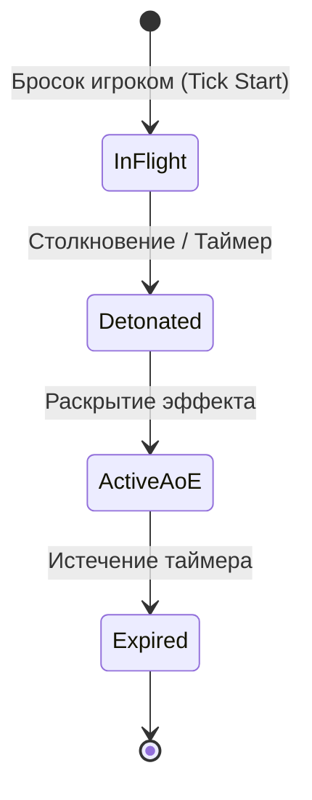
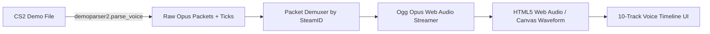

# dem.Toshka Core — Спецификация 2D Demo Vision

**Версия документа:** 1.0  
**Дата:** 23 ноября 2026 г.  
**Модуль:** `dem.Toshka Core :: Demo Vision (2D Interactive Match Replay)`  
**Статус:** Готово к реализации  

---

## 1. Назначение и концепция

**Demo Vision** — это интерактивный 2D-вьювер матчей CS2, работающий полностью локально в десктопном приложении `dem.Toshka`. В отличие от примитивных 2D-радаров прошлых поколений, Demo Vision предоставляет профессиональный уровень визуализации, сравнимый с FACEIT Vision и тренерскими рабочими станциями, но расширенный уникальными возможностями:
1. Синхронизированный многоканальный **Voice Timeline** (прослушивание коллов игроков с привязкой к тикам).
2. Полноценный холст **тактического рисования (Tactical Drawing)** с сохранением слоев.
3. Система доказательных **закладок (Bookmarks)** с привязкой к игрокам и фазам раунда.
4. Точная физика и тайминги всех типов утилити CS2 (дым 20.0 с, молотов 7.03 с, ослепление флешками).

---

## 2. Архитектура 2D Радара и системы координат

### 2.1. Калибровка карт и трансформация координат
CS2 использует трехмерную систему координат `(X, Y, Z)` движка Source 2 в дюймах мира. Для отображения на 2D-радаре координаты преобразуются в проценты относительно квадратного холста `1024x1024`:

$$X_{\%} = \frac{X_{world} - pos\_x}{scale \cdot 1024} \cdot 100\%$$
$$Y_{\%} = \frac{pos\_y - Y_{world}}{scale \cdot 1024} \cdot 100\%$$

*Примечание:* Ось Y в экранных координатах инвертирована относительно игрового мира.

#### База калибровок 11 соревновательных карт
| Карта | `pos_x` | `pos_y` | `scale` | `split_z` (порог высоты) | Многоуровневая |
| :--- | :---: | :---: | :---: | :---: | :---: |
| `de_mirage` | -3230 | 1713 | 5.00 | — | Нет |
| `de_inferno` | -2087 | 3870 | 4.90 | — | Нет |
| `de_dust2` | -2476 | 3239 | 4.40 | — | Нет |
| `de_nuke` | -3453 | 2887 | 7.00 | -480.0 | **Да (Upper / Lower)** |
| `de_vertigo` | -3168 | 1762 | 4.00 | 11700.0 | **Да (51st / 50th floor)** |
| `de_ancient` | -2953 | 2164 | 4.40 | — | Нет |
| `de_anubis` | -2796 | 3328 | 5.22 | — | Нет |
| `de_overpass` | -4820 | 3540 | 5.20 | — | Нет |
| `de_train` | -2487 | 2392 | 4.70 | -100.0 | **Да (Ground / Tunnel)** |
| `de_cache` | -2000 | 3250 | 5.50 | — | Нет |
| `de_tuscan` | -3000 | 4000 | 5.00 | — | Нет |

### 2.2. Обработка многоуровневых карт (`split_z`)
На картах `de_nuke`, `de_vertigo` и `de_train` объекты могут находиться друг под другом.
* Режим **Auto Level:** Слой переключается в зависимости от высоты выбранного в фокус игрока (`Z < split_z` $\rightarrow$ Нижний уровень).
* Режим **Split View:** Полупрозрачное наложение нижнего уровня или ручной тумблер `[Upper / Lower]` в шапке радара.
* Игроки на неактивном уровне отображаются с пониженной прозрачностью (opacity: 0.35) и пунктирным контуром.

---

## 3. Векторные токены игроков и визуал

Токен игрока — это масштабируемый SVG/Canvas элемент с четкой иерархией информации:

```
          [ Направление взгляда (FOV Cone 90°) ]
                     \       /
                      \     /
                       \   /
                     +-------+
                     | [WPN] |   <-- Иконка активного оружия
            [Armor]  |  (3)  |  [Defuser]  <-- Номер / Бейдж кита
                     +-------+
                     [=========]  <-- Кольцо здоровья (HP 0-100%)
                     s1mple [100] <-- Никнейм и текущее HP
```

### 3.1. Элементы токена
1. **Команда и заливка:**
   * **CT (Counter-Terrorists):** Глубокий сине-бирюзовый `Sky-400` (`#38bdf8`), кайма `#0284c7`.
   * **T (Terrorists):** Теплый янтарный `Amber-400` (`#fbbf24`), кайма `#d97706`.
2. **Конус обзора (FOV Cone):**
   * Размах угла: 90 градусов (стандартный горизонтальный FOV игрока).
   * Ориентация: угол рыскания (`yaw`), извлекаемый из демки с точностью до градуса.
   * Длина луча видимости: 75 px (масштабируется с зумом). Плавный градиент затухания к краю конуса.
   * Наклон (`pitch`): при сильном взгляде вниз (например, установка бомбы или дроп утилити под ноги) конус сжимается по радиусу.
3. **Кольцевой индикатор здоровья (HP Ring):**
   * Внешнее кольцо толщиной 2.5 px. При $HP > 50$ — цвет команды; при $20 \le HP \le 50$ — желтый `#eab308`; при $HP < 20$ — критический красный `#ef4444`.
4. **Бейджи экипировки:**
   * Миниатюрная иконка щита (броня) и шлема (`armor_value > 0`, `has_helmet`).
   * Иконка набора сапера (щипцы Defuse Kit для CT).
   * Иконка бомбы C4 у несущего террориста (пульсирующий красный индикатор).
5. **Активное оружие:** Текстовая метка или векторный силуэт (`AK-47`, `M4A1-S`, `AWP`, `Deagle`).
6. **Трейлы движения (Movement Trails):**
   * Линия пути за последние 32 тика (~0.5 сек) с затуханием прозрачности от 0.6 до 0.0. Позволяет видеть вектор ускорения, стрейфы и прыжки.
7. **Режим фокуса (Player POV Focus):**
   * При клике на игрока все остальные токены переходят в режим затенения (opacity: 0.4), а вокруг выбранного игрока отображается пульсирующее кольцо захвата, радиус слышимости шагов (footstep sound radius = ~400 юнитов) и полная траектория раунда.

---

## 4. Визуализация гранат и зон поражения (Utility Engine)

Граната в CS2 проходит 3 фазы: **Полет $\rightarrow$ Детонация $\rightarrow$ Активное действие**.



### 4.1. Спецификация эффектов
| Граната | Визуализация полета | Радиус действия (World) | Время действия | Индикация на радаре |
| :--- | :--- | :---: | :---: | :--- |
| **Smoke Grenade** | Серая дуговая траектория | ~144 units (объемное облако) | **20.00 с** | Серое растущее облако с таймером обратного отсчета в центре `[18.4s]`. Пульсация при рассеивании. |
| **Molotov / Incendiary** | Оранжевая/красная траектория | ~160 units (динамический очаг) | **7.03 с** (Molotov) / **7.03 c** (Inc) | Огненная зона с анимированными языками пламени и счетчиком `[5.2s]`. |
| **Flashbang** | Белая пунктирная дуга | Сфера прямой видимости | 0.5–5.0 с (слепота) | Белая вспышка в точке взрыва. Вокруг ослепленных игроков появляется белое мерцающее кольцо с затуханием длительности ослепления. |
| **HE Grenade** | Зеленая траектория | ~350 units (убывающий урон) | Моментально | Красно-оранжевая ударная волна (Expanding Ring), всплывающие индикаторы суммарного нанесенного урона (`-74 HP`). |
| **Decoy Grenade** | Пунктирная траектория | Точка детонации | 15.0 с | Пульсирующая желтая звуковая волна с иконкой ложного выстрела. |

---

## 5. Временная шкала и управление воспроизведением (Round Timeline)

### 5.1. Элементы управления
* **Кнопки воспроизведения:** `[Play / Pause]` (пробел), `[Step Backward 1 tick / 16 ticks]` (`Left Arrow`), `[Step Forward 1 tick / 16 ticks]` (`Right Arrow`).
* **Скорости воспроизведения:** `0.25x`, `0.5x`, `1.0x` (реалтайм), `2.0x`, `4.0x`.
* **Переход по раундам:** Селектор раунда `[Round 1..24+]` с цветовой индикацией победителя (Синий = CT, Оранжевый = T).
* **Шкала событий раунда (Event Track):**
  * Полоса прогресса раунда от фризтайма (`tick_freeze_end`) до конца раунда (`round_end_tick`).
  * Маркеры ключевых событий:
    * 💀 **Убийство:** красный череп с тултипом (кто, кого, из чего).
    * 💣 **Установка бомбы:** оранжевая иконка C4.
    * 🛡️ **Обезвреживание / Взрыв:** зеленая иконка щипцов / красный гриб взрыва.
    * ⚡ **Первый контакт (Opening Duel):** желтая молния.
    * 🎯 **Клатч-ситуация:** фиолетовый бейдж `1v2`, `1v3`.

### 5.2. Killfeed и статус бомбы
* **Синхронизированный Killfeed:** всплывает в правом верхнем углу радара строго в момент наступления тика убийства с поддержкой бейджей: Headshot, Through Smoke, Wallbang, Blind Kill, No Scope.
* **Индикатор бомбы:**
  * Состояния: `Unplanted` (у террориста / на земле), `Planting` (таймер 3.0 с), `Planted` (обратный отсчет 40.0 с с звуковым/визуальным предупреждением на последних 10 и 5 секундах), `Defusing` (прогресс-бар 5 с с китом / 10 с без кита).

---

## 6. Voice Timeline: Архитектура голосового чата

Инновационный компонент dem.Toshka Core, отсутствующий у коммерческих аналогов.



### 6.1. Технический конвейер обработки звука
1. **Извлечение пакетов:** Вызов `demoparser2.parse_voice(demo_path)` возвращает массив словарей:
   * `packet['tick']`: точный тик записи.
   * `packet['steamid']`: идентификатор говорящего игрока.
   * `packet['data']`: байты фрейма Opus (20 мс аудио, 48 кГц, Silk/Opus).
2. **Проверка наличия данных (`has_voice_data`):**
   * Если массив пакетов пуст (официальные Valve Matchmaking / Premier GOTV серверы вырезают войс), интерфейс Voice Timeline корректно скрывается и выводится статус: *"Голосовой чат отсутствует в файле демки (Valve GOTV convention)"*.
   * Если пакеты есть (FACEIT, Fastcup, турнирные серверы с `tv_transmitoperators 1`, локальные пракки), активируется панель звука.
3. **Группировка и формирование аудио-дорожек:**
   * Пакеты группируются по `steamid` в 10 раздельных потоков.
   * Для воспроизведения в браузере бэкенд на лету оборачивает последовательность пакетов в валидный контейнер Ogg Opus или отдает предсведенные фрагменты через локальный эндпоинт `/api/voice/round/{round_id}`.
4. **Интерфейс Voice Timeline:**
   * 10 дорожек под основной шкалой времени (5 за CT, 5 за T).
   * Визуализация активности: блоки речи с амплитудной волной (Waveform).
   * Органы управления на каждой дорожке:
     * `[M]` — Mute (заглушить игрока).
     * `[S]` — Solo (слушать только данного игрока / IGL).
     * `Vol` — Регулятор громкости 0–100%.
     * 💾 `Export WAV` — Экспорт чистой аудио-дорожки разговоров за раунд.

---

## 7. Модуль тактического рисования (Tactical Drawing Canvas)

Слой рисования расположен поверх интерактивного радара в виде независимого HTML5 Canvas слоя, синхронизированного с зумом и панорамированием карты.

### 7.1. Инструментарий
* ✏️ **Карандаш (Pen / Freehand):** Сглаженные кривые Безье для быстрых пометок от руки.
* ➔ **Направленная стрелка (Directional Arrow):** Вектор атаки, ротации или флангового обхода с наконечником.
* 📏 **Прямая линия (Line / Measure):** Замер дистанций с выводом расстояния в юнитах и метрах.
* ⭕ **Круг / Эллипс (Zone Circle):** Выделение области контроля, зоны раскидки или точки сбора.
* ⬛ **Прямоугольник (Tactical Box):** Зонирование укрытий и плентов (A Site / B Site / Mid).
* 🔤 **Текстовая метка (Text Label):** Подписи таймингов, коллов позиций и тренерских указаний.
* ❌ **Маркер события (Cross / Ping):** Точка предполагаемого контакта или ошибка позиционирования.

### 7.2. Настройки стилей и слоев
* **Палитра:** Неоновый циан `#00f2fe`, тактический желтый `#facc15`, боевой красный `#f43f5e`, зеленый лайм `#4ade80`, пурпурный `#c084fc`, чистый белый `#ffffff`.
* **Толщина штриха:** 2px, 4px, 8px.
* **Привязка слоев:**
  * **Static Frame:** Рисунок виден только на текущем тике/паузе.
  * **Round Persistent:** Схема видна на протяжении всего раунда (для планирования дефолтов).
* **Стек действий:** Полная поддержка Undo (`Ctrl+Z`), Redo (`Ctrl+Y`), очистки холста (`Clear All`).
* **Экспорт:** Сохранение тактической схемы в формате PNG высокой четкости с легендой и логотипом dem.Toshka.

---

## 8. Закладки и проекты анализа (Bookmarks & Projects)

### 8.1. Структура закладки (Bookmark)
Каждая закладка привязывается к координатам и времени:
* `id`: UUID.
* `match_id`, `round_id`, `tick`: Точная временная позиция.
* `player_steamid`: Игрок, находящийся в фокусе (опционально).
* `category`: `Tactical Mistake` | `Clutch Moment` | `Utility Setup` | `Communication Error` | `Great Play`.
* `title`: Краткий заголовок (например, *"Опоздание на ротацию B при установке бомбы"*).
* `note`: Развернутый комментарий тренера.
* `canvas_data`: Сериализованный векторный снимок слоя рисования.

### 8.2. Сохранение проекта разбора (`.dtproj`)
Пользователь может сохранить полный сеанс разбора матча:
* Все созданные закладки.
* Все тактические схемы и слои рисования.
* Пользовательские метки игроков и заметки.
* Проект может быть открыт повторно на любом компьютере с установленным `dem.Toshka Core` без необходимости повторного парсинга демки.
