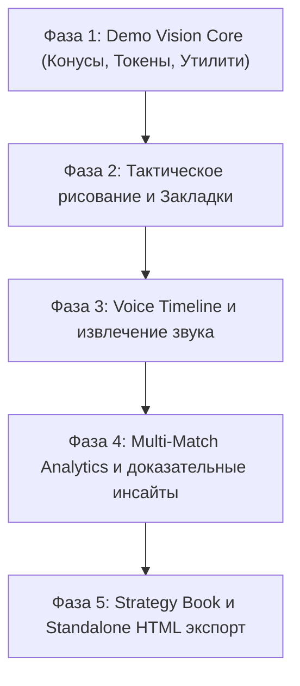

# dem.Toshka Core — Дорожная карта реализации (Implementation Roadmap)

**Версия документа:** 1.0  
**Дата:** 23 ноября 2026 г.  
**Проект:** `dem.Toshka Core`  
**Статус:** Готово к согласованию и поэтапному выполнению  

---

## 1. Стратегия реализации и безопасность кодовой базы

Для обеспечения надежности и предотвращения регрессий в существующей системе (где уже успешно проходят **351 unit-тест** и собирается фронтенд) разработка разбивается на **5 изолированных фаз**. 

Каждая фаза:
* Имеет строгие и измеримые **критерии приёмки (Acceptance Criteria)**.
* Сопровождается автоматизированными тестами на реальных демках (`test.dem`, `anubis1410.dem`).
* Не ломает обратную совместимость существующей базы SQLite и пользовательских клипов.
* Строго соблюдает разделение: `Core` (аналитика/радар/плейбук) $\leftrightarrow$ `Cinematic Studio` (HLAE/камеры/рендер).

---

## 2. Фазы разработки и критерии приёмки

---

### Фаза 1: Demo Vision Engine — Векторные токены, конусы обзора и жизненный цикл утилити
**Фокус:** Качественный скачок базового 2D-радара до уровня современных соревновательных вьюверов.

* **Задачи Backend:**
  * Расширить `backend/parser/replay.py`: добавить в `parse_ticks` извлечение `pitch`, `yaw`, `armor_value`, `has_defuser`, `active_weapon_name`.
  * Интегрировать парсинг игровых событий детонации утилити: `smokegrenade_detonate`, `smokegrenade_expired`, `inferno_startburn`, `inferno_expire`, `flashbang_detonate`, `player_blind`.
  * Рассчитывать точные тайминги активности: дым (20.0 с), огонь (7.03 с), таймер обратного отсчета.
* **Задачи Frontend:**
  * Обновить компонент токена игрока в `TacticalReplayRadar.tsx`: отрисовка конуса видимости (FOV Cone 90°) по реальному углу `yaw`, индикатор брони, дефьюз-кита и иконка оружия.
  * Визуализация зон действия: расширяющийся круг смока с таймером в секундах, анимированная зона молотова, индикация ослепления игроков.
  * Трейлы перемещения (хвосты траектории за последние 32 тика с градиентом затухания).
* **Критерии приёмки (Acceptance Criteria):**
  1. На реальной демке `anubis1410.dem` токены всех 10 игроков отображают корректное направление взгляда и поворачиваются синхронно с движениями прицела.
  2. При взрыве смока на радаре отображается круг радиусом ~144 юнита с обратным отсчетом времени от 20.0 с до 0.0 с.
  3. Все существующие 351 unit-тест проходят без ошибок (`pytest`).
  4. Сборка фронтенда (`npm run build`) завершается с кодом 0.

---

### Фаза 2: Слой тактического рисования (Tactical Drawing) и система закладок (Bookmarks)
**Фокус:** Превращение 2D-радара в инструмент тактического разбора для тренеров и игроков.

* **Задачи Backend:**
  * Применить миграцию SQLite: создание таблиц `analysis_projects`, `tactical_drawings`, `bookmarks`.
  * Реализовать REST API эндпоинты: CRUD для проектов, сохранение векторных слоев рисования, сохранение закладок.
* **Задачи Frontend:**
  * Реализовать прозрачный HTML5 Canvas оверлей поверх радара с синхронизацией масштабирования (Zoom/Pan).
  * Панель инструментов: Карандаш (сглаженные кривые Безье), Направленная стрелка атаки, Линия замера дистанции, Круг зоны, Прямоугольник укрытия, Текстовая метка.
  * Цветовая палитра (Циан, Желтый, Красный, Зеленый, Пурпурный, Белый), выбор толщины штриха, Undo/Redo (`Ctrl+Z` / `Ctrl+Y`), ластик.
  * Боковая панель закладок (Bookmarks Drawer): добавление заметки к текущему тику, список закладок раунда, мгновенный прыжок плейхеда при клике на закладку с подсветкой игрока.
* **Критерии приёмки:**
  1. Пользователь может нарисовать схему атаки, переключить раунд, вернуться назад — схема сохраняется и загружается из SQLite.
  2. Клик по закладке в боковой панели плавно перематывает плейхед Demo Vision на сохраненный тик.
  3. Экспорт снимка тактической схемы в PNG разрешением не менее 1920x1080.

---

### Фаза 3: Voice Timeline — Извлечение звука и многоканальный таймлайн
**Фокус:** Уникальное конкурентное преимущество dem.Toshka — прослушивание внутриигровой коммуникации.

* **Задачи Backend:**
  * Создать модуль `backend/parser/voice.py`, использующий нативный `demoparser2.parse_voice()`.
  * Детектор наличия звуковых данных (`has_voice_data`): проверка наличия Opus-пакетов при парсинге.
  * Группировка пакетов по `steamid` и транскодирование в стриминговые контейнеры Ogg Opus / WAV.
  * Эндпоинты `/api/replay/{demo_id}/round/{round_id}/voice` и экспорт WAV фрагмента.
* **Задачи Frontend:**
  * 10-канальная панель Voice Timeline под шкалой раунда (5 дорожек CT, 5 дорожек T).
  * Отрисовка амплитудной волны (Waveform) активности каждого игрока.
  * Индивидуальные контролы на каждой дорожке: Mute `[M]`, Solo `[S]`, Volume slider.
  * Синхронное воспроизведение звука со скраббингом тиков на таймлайне.
  * Корректный статус-бейдж при отсутствии войса в демке (для стандартных Valve GOTV файлов).
* **Критерии приёмки:**
  1. На демке с голосовыми данными (`test.dem` или FACEIT) звук успешно воспроизводится в браузере синхронно с движениями токена говорящего игрока.
  2. Режим Solo корректно изолирует голос капитана/тиммейта.
  3. При отсутствии пакетов войса интерфейс не выдает ошибок, а корректно отображает информационную плашку.

---

### Фаза 4: Multi-Match Player Analytics и доказательные рекомендации
**Фокус:** Анализ серий из 10–50 матчей, выявление хронических ошибок и 7-компонентные инсайты.

* **Задачи Backend:**
  * Применить миграцию SQLite: таблицы `player_profiles`, `player_match_stats`, `player_insights`.
  * Модуль агрегации метрик: расчет Crosshair Placement Error, TTK, процента безответных смертей (Untradeable Deaths), точности трейдов (Trade Kill Conversion за 4.0 с), коэффициента ослепления тиммейтов (Team Flash Ratio).
  * Генератор доказательных рекомендаций, строго соблюдающий 7-компонентный контракт.
* **Задачи Frontend:**
  * Раздел Player Analytics в UI: лепестковая диаграмма компетенций (Skill Radar), динамика по картам, CT/T сплит, статистика по ролям.
  * Карточки рекомендаций: вывод паттерна, выборки, объективных метрик, альтернативы и кнопки прямого перехода `[Перейти в Demo Vision ➔]`.
* **Критерии приёмки:**
  1. При выборе профиля игрока агрегируются данные по всем импортированным демкам.
  2. В карточке рекомендации клик по кнопке перехода мгновенно открывает Demo Vision на указанном раунде и тике с фокусом на игроке.
  3. Отсутствуют псевдонаучные формулировки (полное соответствие правилам разграничения корреляции и причинности).

---

### Фаза 5: Strategy Book и Standalone Single-File HTML Export
**Фокус:** Полноценный тактический плейбук команды и автономный оффлайн-экспорт для печати в PDF.

* **Задачи Backend:**
  * Таблицы SQLite: `strategy_books`, `tactical_setups`, `utility_lineups`.
  * Генератор автономного HTML (`backend/services/strategy_exporter.py`): сборка HTML5-документа с инлайновыми SVG-радарами, стилями Tailwind/Dark Cyberpunk, скриптами управления и JSON-моделью тактик.
* **Задачи Frontend:**
  * Раздел Strategy Book: 11 интерактивных секций, визуальный конструктор сетапов (Drag & Drop токенов игроков, фазы раунда).
  * Библиотека гранат (Utility Book) с превью и фильтрами по картам и сторонам.
  * Кнопка «Экспорт в автономный HTML» и режим печати буклета A4 (`Ctrl+P` / Save to PDF).
* **Критерии приёмки:**
  1. Сгенерированный HTML-файл открывается двойным кликом на любом ПК без доступа в интернет и сторонних серверов.
  2. Все SVG-карты, схемы заходов и фильтры гранат работают полностью оффлайн.
  3. Печать в PDF формирует чистый структурированный буклет с контрастным стилем для печати.

---

## 3. Матрица рисков и стратегия их снижения

| Риск | Вероятность | Влияние | Стратегия снижения |
| :--- | :---: | :---: | :--- |
| **Высокая нагрузка при парсинге тиков для 2D-радара** | Средняя | Высокое | Использовать прореживание тиков (step 16 тиков для базового обзора, step 4 для замедленного воспроизведения). Кэшировать распарсенные раунды в локальный SQLite/Parquet. |
| **Большой объем Opus-пакетов при декодировании звука** | Средняя | Среднее | Потоковое извлечение пакетов только для запрашиваемого раунда; хранение сырых пакетов в компактном сжатом виде без разжатия в тяжелые WAV на диске. |
| **Различия в форматах демок (Valve MM vs FACEIT vs HLTV)** | Высокая | Высокое | Автоматическое определение источника демки; изоляция специфичных полей через безопасные геттеры с дефолтными значениями (`dict.get`). |
| **Утечка приватных тактик при шеринге** | Низкая | Высокое | Полная локальность приложения; автономный HTML генерируется локально и отдается в руки пользователя без отправки на облачные серверы. |
| **Поломка обратной совместимости базы SQLite** | Низкая | Критическое | Использование транзакционных инкрементальных миграций; создание автоматического бэкапа файла `.db` перед обновлением схемы. |
