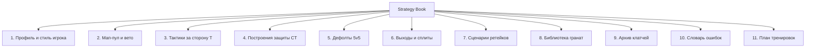

# dem.Toshka Core — Спецификация тактической книги (Strategy Book)

**Версия документа:** 1.0  
**Дата:** 23 ноября 2026 г.  
**Модуль:** `dem.Toshka Core :: Strategy Book & Standalone Playbook Engine`  
**Статус:** Готово к реализации  

---

## 1. Концепция и назначение

**Strategy Book** — это встроенная интерактивная база тактических знаний игрока и команды, органично связывающая аналитику разобранных демок с практическим планированием тренировочного процесса и соревновательных матчей.

Главная проблема современного киберспорта в CS2: тактические наработки тренеров и капитанов (IGL) хранятся разрозненно (папки со скриншотами, текстовые каналы Discord, Google Docs, видео в Telegram). Strategy Book объединяет все аспекты подготовки в единую цифровую систему и решает задачу шеринга через **автономный однофайловый HTML-экспорт (Standalone Offline Single-File HTML)**, который открывается без интернета на любом устройстве и готов к печати в PDF.

---

## 2. Структура тактической книги (11 разделов)

### Раздел 1: Профиль и стиль игрока (My Profile & Identity)
* **Роли и специализация:** Основная роль (Entry, AWPer, IGL, Lurker, Support, Anchor), вторичная роль.
* **Игровой архетип:** Агрессивный спейсер, пассивный опорник, клатчер, плеймейкер.
* **Сигнатурные девайсы:** Распределение эффективности по оружию (AK-47, M4A1-S, AWP, Galil, MP9, Desert Eagle).
* **Коммуникационные протоколы:** Стандарты подачи инфы (краткие коллы, тайминги урона, правила радиотишины в клатче).

### Раздел 2: Мап-пул и руководство по вето (Map Pool & Veto Guide)
* Рейтинг уверенности на всех 7 турнирных картах (Tier 1 Comfort $\rightarrow$ Permaban).
* Протокол банов для Bo1 и Bo3: кого банить первым номером, пик на выбор своей команды, десайдер.
* Специфика сторон на каждой карте (сильная/слабая сторона, приоритет выбора ножевого раунда/стороны).

### Раздел 3: Философия атаки (T Side Playbook)
* Принципы контроля ключевых зон карты (Default Stage: 1:55 – 1:15).
* Сценарии развития раунда:
  * *Fast Push:* Скоростной навал на тайминге первых респов.
  * *Split Execute:* Одновременный выход с двух направлений (например, Mirage A Split через Ramp и Palace).
  * *Slow Contact:* Бесшумное стягивание без ранней утилити с поиском первого фрага.
  * *Fake & Rotate:* Имитация захода на точку А с последующим тихим переходом на B.

### Раздел 4: Построения обороны (CT Side Defensive Setups)
* Конфигурации распределения игроков: `2-1-2` (классика), `3-0-2` (акцент на точку), `1-3-1` (агрессивный контроль центра).
* Протоколы первого контакта: действия при обнаружении раша, использование задерживающих молотовых и флешек под отход.
* Вторичные углы (Off-angles) и перекрестные позиции (Crossfires).

### Раздел 5: Дефолты 5v5 (Default Setups)
* Пошаговые радарные схемы для каждого игрока команды (`P1` – `P5`) на первые 45 секунд раунда.
* Назначение зон ответственности, последовательность броска стартовой утилити, триггеры для отступления или агрессии.

### Раздел 6: Выходы и сплиты (Executes & Set Pieces)
* Тактические «сетапы»: таймлайн координации гранат.
  * *Секунда 0:* Бросок глубокого дыма.
  * *Секунда +2:* Отрезающий молотов в укрытие.
  * *Секунда +4:* Две напрыгивающие ослепляющие гранаты (Pop-flashes).
  * *Секунда +5:* Вход пары энтри-фраггеров с жестким спейсингом и проверкой углов.
* Схемы постановки бомбы (Planting Safe vs Planting for Open) и распределение позиций пост-плента (360° Crossfire).

### Раздел 7: Ретейки (Retake Protocols)
* Выбивание точки A / B в меньшинстве и равных составах ($3v3$, $3v2$, $4v3$).
* Скоординированные ретейк-флешки через крыши и смоки.
* Расчет таймингов: дефьюз-фейк, прикрытие сапера, отсечение люркеров.

### Раздел 8: Каталог раскидок (Utility Book)
* Интерактивная база гранат по каждой карте с фильтрами: тип (Smoke, Flash, Molotov, HE), сторона (CT/T), сложность броска.
* Теги механики броска: `Jumpthrow`, `Runthrow`, `Walkthrow`, `Crouchthrow`, `Standing`.
* Точные координаты броска, точка прицеливания (Crosshair Aim), скриншот ориентира и финальная зона действия на радаре.

### Раздел 9: Архив клатчей (Clutch Library)
* Разбор успешных и проигранных ситуаций $1vX$, импортированных напрямую из Demo Vision.
* Ключевые выводы по каждой ситуации: тайминг чека позиций, выбор момента разминирования, сохранение самообладания.

### Раздел 10: Словарь ошибок и анти-паттернов (Mistakes Dictionary)
* Личный реестр хронических ошибок игрока:
  * Повторный пик без информации.
  * Агрессия на таймере установки бомбы.
  * Неправильный выбор оружия на форс-раунде.
* Привязанные упражнения на исправление (Aim Botz, YPrac Pre-fire, Refrag).

### Раздел 11: План тренировок и разминки (Training & Warmup Plan)
* Индивидуальный ежедневный распорядок (Daily Routine):
  * Разминка кистей и реакция (10 мин).
  * Механика стрейфов и пре-эйма на префаер-картах (20 мин).
  * Deathmatch / FFA (20 мин).
  * Тактический разбор демок в dem.Toshka (30 мин).
* Расписание командных пракков и разборов ошибок.

---

## 3. Встроенный визуальный редактор (In-App Visual Editor)

В приложении `dem.Toshka Core` редактор тактик работает в тесной связке с движком Demo Vision:
1. **Перетаскивание токенов (Drag & Drop):** Размещение фишек игроков (`CT1..CT5`, `T1..T5`) на калиброванном радаре с возможностью поворота угла обзора колесиком мыши.
2. **Фазы тактики (Multi-Phase Timeline):** Разбиение розыгрыша на фазы: *Фаза 1: Занятие позиций* $\rightarrow$ *Фаза 2: Раскидка* $\rightarrow$ *Фаза 3: Контакт* $\rightarrow$ *Фаза 4: Пост-плент*.
3. **Прямой захват из матча:** Возможность в один клик скопировать реальное расположение игроков из разобранной демки прямо в редактор тактики.

---

## 4. Спецификация автономного экспорта (Single-File Offline HTML)

Экспортируемый плейбук представляет собой **один самостоятельный HTML-файл** (`StrategyBook_de_mirage.html` или полный `StrategyBook_Team_2026.html`), не требующий подключения к интернету, веб-сервера или установки дополнительного ПО.

### 4.1. Архитектура файла
* **HTML5 структура:** Строгий валидный документ UTF-8.
* **Inline CSS:** Современный адаптивный UI в фирменной темной тактической стилистике dem.Toshka (Dark Slate `#0f172a`, Cyan `#00f2fe`, Amber `#f59e0b`).
* **Встроенные векторные карты (Embedded SVG Radars):** Схемы соревновательных карт встроены прямо в DOM в виде легковесных SVG, сохраняя идеальную четкость при любом масштабировании.
* **Inline JavaScript (Vanilla ES6):** Полная интерактивность без внешних библиотек (React, Vue, jQuery не требуются). Интерактивное переключение разделов, фильтрация гранат, переключение шагов тактики, отображение тултипов.
* **Данные в JSON:** Все тактики, игроки и раскидки сериализованы внутри тега `<script id="strategy-data" type="application/json">` и доступны для парсинга сторонними скриптами.

### 4.2. Адаптивность и печать (Print & PDF Ready)
Файл содержит специализированный медиа-запрос `@media print`:
* Фон переключается на чистый белый, текст — на глубокий черный `#111827` для экономии тонера.
* Радары конвертируются в высококонтрастный монохромный вектор.
* Автоматическая разбивка на страницы (`page-break-inside: avoid`) для каждого раздела и тактической схемы.
* Идеально печатается стандартным средством Windows `Печать в PDF` (`Ctrl+P`) в виде карманного буклета формата A4 для игроков и тренера на лан-турнире.
